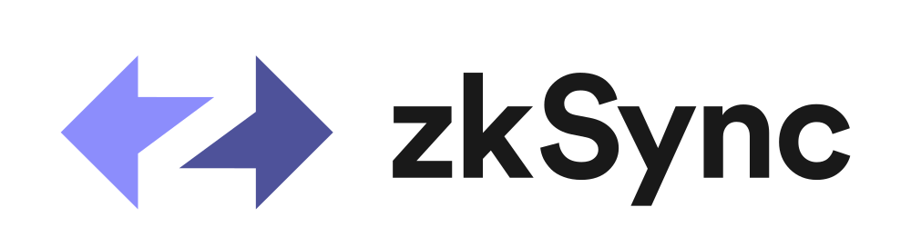

# ZKSync: scaling and privacy engine for Ethereum

[](https://zksync.io/)


> **⚠️ Deprecation Notice**
>
> ZKSync Lite is being deprecated. To withdraw your funds, please visit
> [lite.zksync.io](https://lite.zksync.io).

## Withdrawing your funds with the Exit Tree Generator

If you prefer to generate your withdrawal proof independently rather than use the web interface, you can use the
[Exit Tree Generator](core/bin/exit_tree_generator/README.md). The flow is three steps:

### 1. Download the data

Download the snapshot of the ZKSync Lite state at the last verified block from:

<https://zksync-lite-sunset.matterlabs.dev/mainnet/data.zip>

or IPFS CID:
QmSqzPQNRcz3grznTMCYDDunDFGZCXFFjew7fgYpFcGYoh

The archive contains `accounts.csv`, `balances.csv`, and `tokens.csv`.

### 2. Create leaves for the Keccak tree

```bash
cargo run --release --bin zksync_exit_tree_generator -- create-new-leaves \
    --accounts accounts.csv \
    --balances balances.csv \
    --tokens tokens.csv \
    [--output new_leaves.csv]
```

### 3. Create a proof and claim

```bash
cargo run --release --bin zksync_exit_tree_generator -- create-proof \
    --account <YOUR_ACCOUNT_ADDRESS> \
    --tokens <TOKEN_ADDRESS_1> [<TOKEN_ADDRESS_2> ...] \
    [new_leaves.csv]
```

Submit the printed proof to the withdrawal contract.

**Mainnet:**: https://etherscan.io/address/0x0a14b696350546110a0d8acdb86226983af9d2a0

The contract exposes two methods for claiming:

- **`claim`** — withdraws the funds to the caller (`msg.sender`). Use this when the wallet submitting the
  transaction is the address that held the ZKSync Lite account.
- **`claimTo`** — withdraws the funds to a specified recipient address. Use this when you want the funds sent
  somewhere other than the caller (for example, a cold wallet or a different EOA).

Both methods take the account address, the token addresses, and the proof produced in step 3. You can
call them from Etherscan's "Write Contract" tab, or from any wallet/script that can encode a contract call.

For advanced workflows — including verifying the Keccak Merkle root, restoring the original ZKSync Merkle root (a
heavy computational task, ~6 hours) and restoring the tree from a database — see the
[Exit Tree Generator README](core/bin/exit_tree_generator/README.md).

## ZKSync Lite

ZKSync Lite is a scaling and privacy engine for Ethereum. Its current functionality scope includes low gas transfers of ETH
and ERC20 tokens in the Ethereum network.

## Description

ZKSync is built on ZK Rollup architecture. ZK Rollup is an L2 scaling solution in which all funds are held by a smart
contract on the mainchain, while computation and storage are performed off-chain. For every Rollup block, a state
transition zero-knowledge proof (SNARK) is generated and verified by the mainchain contract. This SNARK includes the
proof of the validity of every single transaction in the Rollup block. Additionally, the public data update for every
block is published over the mainchain network in the cheap calldata.

This architecture provides the following guarantees:

- The Rollup validator(s) can never corrupt the state or steal funds (unlike Sidechains).
- Users can always retrieve the funds from the Rollup even if validator(s) stop cooperating because the data is
  available (unlike Plasma).
- Thanks to validity proofs, neither users nor a single other trusted party needs to be online to monitor Rollup blocks
  in order to prevent fraud.

In other words, ZK Rollup strictly inherits the security guarantees of the underlying L1.  L2.

To learn how to use ZKSync, please refer to the [ZKSync SDK documentation](https://zksync.io/api/sdk/).

## Development Documentation

The following guides for developers are available:

- Installing development dependencies: [docs/setup-dev.md](docs/setup-dev.md).
- Launching ZKSync locally: [docs/launch.md](docs/launch.md).
- Development guide: [docs/development.md](docs/development.md).
- Repository architecture overview: [docs/architecture.md](docs/architecture.md).

## Projects

- [ZKSync server](core/bin/server)
- [ZKSync prover](core/bin/prover)
- [ZKSync explorer](infrastructure/explorer)
- [JavaScript SDK](sdk/zksync.js)
- [Rust SDK](sdk/zksync-rs)

## Changelog

Since the repository is big and is split into independent components, there is a different changelog for each of its
major parts:

- [Smart contracts](changelog/contracts.md)
- [Core](changelog/core.md)
- [Infrastructure](changelog/infrastructure.md)
- [JavaScript SDK](changelog/js-sdk.md)
- [Rust SDK](changelog/rust-sdk.md)

## License

ZKSync is distributed under the terms of both the MIT license and the Apache License (Version 2.0).

See [LICENSE-APACHE](LICENSE-APACHE), [LICENSE-MIT](LICENSE-MIT) for details.
